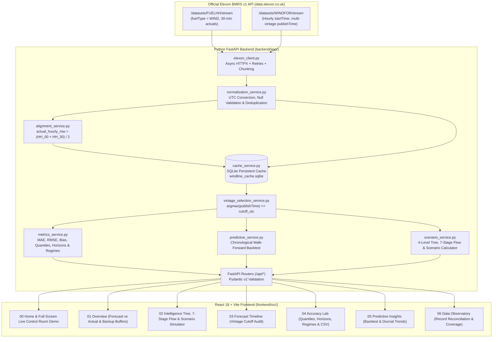
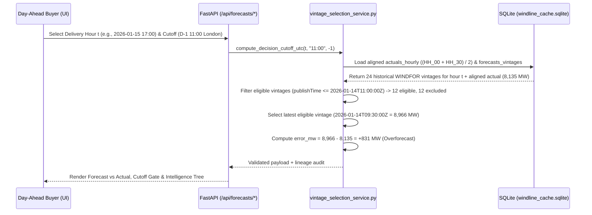

# WINDLINE — UK Day-Ahead Wind Forecast Intelligence

**WINDLINE** is a full-stack web application built for a UK electricity utility's day-ahead procurement team. It reconstructs the exact national wind generation forecast available at the day-ahead purchasing cutoff (default **`11:00 Europe/London on D-1`**) and quantitatively evaluates forecast accuracy across **January 2026** using official **Elexon BMRS (`FUELHH` & `WINDFOR`)** datasets.

---

## Live Deployed Application

- **Live Web Application:** [https://prod-main-app-4c4b86-00va318mcjr.compute.instacloud-edge.com](https://prod-main-app-4c4b86-00va318mcjr.compute.instacloud-edge.com)
- **Live API Health Check:** [https://prod-main-app-4c4b86-00va318mcjr.compute.instacloud-edge.com/api/health](https://prod-main-app-4c4b86-00va318mcjr.compute.instacloud-edge.com/api/health)
- **Interactive OpenAPI Documentation:** [https://prod-main-app-4c4b86-00va318mcjr.compute.instacloud-edge.com/docs](https://prod-main-app-4c4b86-00va318mcjr.compute.instacloud-edge.com/docs)

---

## Key January 2026 Findings (`D-1 11:00 Europe/London` Cutoff)

| Metric | Verified Value | Operational Meaning |
| :--- | :--- | :--- |
| **Evaluation Scope** | `2026-01-01` to `2026-01-31` | `744 / 744` valid aligned hours (`100.0%` coverage) |
| **Mean Absolute Error (MAE)** | **`2,122.81 MW`** | Median Absolute Error: `1,714.00 MW` |
| **Root Mean Squared Error (RMSE)** | **`2,616.69 MW`** | Penalizes large storm ramp errors (`1.23x` MAE) |
| **Mean Forecast Bias** | **`+1,840.30 MW`** | `error_mw = forecast_mw - actual_mw` (`+` = Overforecast) |
| **Overforecast / Underforecast Split** | **`84.41%` / `15.59%`** | `628` hours overforecast (`+`) vs. `116` hours underforecast (`-`) |
| **Quantified Backup Buffers** | `P50: 1,641 MW` • `P75: 2,991 MW` • `P90: 4,312 MW` | Recommended wind shortfall buffers for thermal reserve planning |
| **Accuracy by Wind Output Level (Quantiles)** | `Low (<=P33: 9,367 MW): MAE 1,840 MW`<br>`Med (P33–P67: 9,367–14,670 MW): MAE 2,031 MW`<br>`High (>P67: >14,670 MW): MAE 2,497 MW` | Computed from empirical tertile quantiles of January 2026 actual wind generation |

---

## System Architecture & Data Pipeline (Mermaid Diagrams)

### 1. End-to-End System Architecture



### 2. Historical Decision Cutoff & Alignment Logic



---

## Directory & File Structure

```text
.
├── Dockerfile                                 # Unified multi-stage production container (React SPA + FastAPI)
├── docker-compose.yml                         # Multi-container local compose (backend:8000 + frontend:8080)
├── render.yaml                                # Cloud deployment blueprint
├── .env.example                               # Environment variable template (no secrets)
├── README.md                                  # Project documentation
├── backend/
│   ├── Dockerfile                             # Backend service Dockerfile
│   ├── requirements.txt                       # Python dependencies (FastAPI, Pandas, NumPy, HTTPX, Scikit-Learn, Pytest)
│   ├── app/
│   │   ├── main.py                            # FastAPI entrypoint, CORS & static SPA mount
│   │   ├── config.py                          # Environment-based configuration & Elexon URLs
│   │   ├── api/
│   │   │   ├── health.py                      # GET /api/health
│   │   │   ├── ingestion.py                   # GET /api/ingest/status, POST /api/ingest/run
│   │   │   ├── forecasts.py                   # GET /api/forecasts/selected, /vintages, /intelligence/tree, POST /api/scenario/simulate
│   │   │   ├── metrics.py                     # GET /api/metrics/summary, /daily, /lead-time, /api/export/csv
│   │   │   ├── predictive.py                  # GET /api/predictive/summary, /backtest
│   │   │   └── data_quality.py                # GET /api/data-quality
│   │   ├── models/
│   │   │   └── schemas.py                     # Pydantic v2 request/response schemas
│   │   └── services/
│   │       ├── elexon_client.py               # Async HTTPX client for Elexon FUELHH & WINDFOR streams
│   │       ├── ingestion_service.py           # Ingestion pipeline coordinator
│   │       ├── normalization_service.py       # UTC normalization, validation & deterministic deduplication
│   │       ├── alignment_service.py           # Half-hourly (:00, :30) to hourly average alignment
│   │       ├── vintage_selection_service.py   # Historical decision cutoff gate (publishTime <= cutoff_utc)
│   │       ├── metrics_service.py             # MAE, RMSE, Bias, P05-P95 quantiles, lead horizons & quantile regimes
│   │       ├── trend_analysis_service.py      # Diurnal hour-of-day profile & 24h rolling variability
│   │       ├── predictive_service.py          # Leak-free expanding-window walk-forward backtest
│   │       ├── scenario_service.py            # 4-Level Intelligence Tree, 7-Stage Flow & Scenario Simulator
│   │       └── cache_service.py               # Persistent SQLite storage layer
│   ├── data/
│   │   ├── windline_cache.sqlite              # Pre-populated January 2026 Elexon SQLite database (744 valid hours)
│   │   └── raw_extracts/                      # Reproducible raw Elexon extract metadata
│   └── tests/
│       └── test_windline_core.py              # Pytest unit & API test suite (9 tests)
└── frontend/
    ├── Dockerfile                             # Frontend multi-stage Node + Nginx Dockerfile
    ├── nginx.conf                             # Nginx reverse-proxy configuration
    ├── package.json                           # Frontend dependencies (React 18, Vite 5, Recharts, Framer Motion, Vitest)
    ├── vercel.json                            # Vercel SPA routing configuration
    ├── vite.config.js                         # Vite build & proxy configuration
    └── src/
        ├── App.jsx                            # Main navigation, global cutoff ribbon & view router
        ├── main.jsx                           # React DOM root
        ├── components/
        │   ├── BusinessScenarioSimulator.jsx  # Isolated hypothetical demand & residual thermal calculator
        │   ├── DataLineagePipeline.jsx        # Animated 7-stage data flow & cutoff filter visualization
        │   ├── EnergyIntelligenceTree.jsx     # Interactive 4-level SVG tree with zoom/fit & node inspector
        │   └── StateBanners.jsx               # Accessible loading, error & empty state banners
        ├── pages/
        │   ├── LandingPage.jsx                # Editorial home page & interactive 2D SVG cutoff preview
        │   ├── LiveControlRoomDemo.jsx        # Full-screen UK wind control room demo & 7-node tree
        │   ├── OverviewPage.jsx               # January 2026 summary, charts & thermal backup buffers
        │   ├── IntelligenceTreePage.jsx       # Single-hour tree, lineage & scenario workspace
        │   ├── ForecastTimelinePage.jsx       # Vintage publication evolution & cutoff gate audit
        │   ├── AccuracyLabPage.jsx            # Error distributions, quantiles, horizons, regimes & CSV export
        │   ├── PredictiveInsightsPage.jsx     # Walk-forward backtest & historical wind trends
        │   └── DataObservatoryPage.jsx        # Record reconciliation audit & 31-day coverage matrix
        ├── services/
        │   └── apiClient.js                   # Frontend HTTP client
        ├── styles/
        │   └── tokens.css                     # Central CSS design tokens
        ├── tests/
        │   └── App.test.jsx                   # Vitest component & navigation test suite (5 tests)
        └── utils/
            └── formatters.js                  # Tabular number, unit & timestamp formatters
```

---

## Official Data Sources & Methodology

1. **Actual Wind Generation (`FUELHH` Stream):**
   - **Endpoint:** [https://bmrs.elexon.co.uk/api-documentation/endpoint/datasets/FUELHH/stream](https://bmrs.elexon.co.uk/api-documentation/endpoint/datasets/FUELHH/stream) (`https://data.elexon.co.uk/bmrs/api/v1/datasets/FUELHH/stream`, filtered to `fuelType = WIND`).
   - **Half-Hourly to Hourly Alignment:** `FUELHH` provides 30-minute settlement periods (`:00` and `:30`), whereas `WINDFOR` forecasts are hourly (`:00`). Each pair of valid half-hourly observations is averaged into an hourly figure:
     ```text
     actual_hourly_mw = (actual_at_hour_start_mw + actual_at_half_hour_mw) / 2
     ```
   - **Record Reconciliation:** `1,680` total `FUELHH` records ingested = `1,488` January 2026 half-hourly records (`744` aligned hours, `100%` coverage) + `192` December 28–31, 2025 half-hourly records (`96` aligned hours retained for lag context). Missing values are never converted to zero.

2. **Historical Wind Forecasts (`WINDFOR` Stream):**
   - **Endpoint:** [https://bmrs.elexon.co.uk/api-documentation/endpoint/datasets/WINDFOR/stream](https://bmrs.elexon.co.uk/api-documentation/endpoint/datasets/WINDFOR/stream) (`https://data.elexon.co.uk/bmrs/api/v1/datasets/WINDFOR/stream`).
   - **Historical Decision Cutoff Selection:** For each target delivery hour `t`, given a decision cutoff `C` (default `11:00 Europe/London on D-1`, configurable in the UI), the platform selects the record with the greatest `publishTime` satisfying:
     ```text
     forecast.startTime == t   AND   forecast.publishTime <= C
     ```
     Forecasts published after `C` (`publishTime > C`) are visibly excluded so future information never leaks into historical decision evaluation.
   - **Record Reconciliation:** `21,024` raw `WINDFOR` records fetched across publication windows from December 27, 2025 to January 31, 2026 minus `416` out-of-window target hours = `20,608` validated records across `288` distinct `publishTime` vintages (`18,080` targeting January 2026 hours, averaging `24.3` vintages per hour).

3. **Forecast Error Convention:**
   ```text
   error_mw = forecast_mw - actual_hourly_mw
   ```
   - **Positive (`+`):** Overforecasting (actual wind was lower than forecast; wind shortfall).
   - **Negative (`-`):** Underforecasting (actual wind was higher than forecast; wind surplus).

---

## How to Start the Application

### Option 1: Docker & Docker Compose Commands

```bash
# 1. Build and start both backend (port 8000) and frontend (port 8080) containers
docker compose up --build -d

# 2. Verify container status and health endpoints
docker compose ps
curl http://localhost:8000/api/health
curl -I http://localhost:8080/

# 3. Stop containers
docker compose down
```

**Single Unified Container Build (Root `Dockerfile`):**
```bash
docker build -t windline-app:1.0.0 .
docker run -d -p 8080:8080 --name windline-app windline-app:1.0.0
```
- Open `http://localhost:8080` in your browser (click **`Launch Live Demo`** in the top bar to open the full-screen control room view).

**Docker Hub Tag, Push & Pull Commands:**
```bash
docker login
docker build -t <dockerhub-username>/windline-backend:1.0.0 ./backend
docker build -t <dockerhub-username>/windline-frontend:1.0.0 ./frontend
docker push <dockerhub-username>/windline-backend:1.0.0
docker push <dockerhub-username>/windline-frontend:1.0.0
```

---

### Option 2: Local Development (Python & Node.js)

**1. Start the FastAPI Backend (`http://127.0.0.1:8000`):**
```bash
cd backend
pip install -r requirements.txt
python -m uvicorn app.main:app --host 127.0.0.1 --port 8000 --reload
```

**2. Start the React + Vite Frontend (`http://localhost:5173`):**
```bash
cd frontend
npm install
npm run dev
```

---

## Running Automated Tests

```bash
# Backend Unit & API Tests (9 passed)
cd backend
python -m pytest -v

# Frontend Component Tests & Production Build (5 passed)
cd frontend
npm run test
npm run build
```

---

## Research & AI-Tool Disclosure

- **Domain Research (Perplexity):** **Perplexity** was used during initial domain research to study UK wholesale day-ahead electricity market gate-closure conventions, National Grid ESO / Elexon BMRS settlement period structures, and the exact query parameter behavior of the official Elexon `FUELHH/stream` and `WINDFOR/stream` endpoints.
- **Development Assistance:** AI coding assistance was used to accelerate FastAPI Pydantic schema definitions, React/SVG component layout scaffolding, and unit test boilerplate. All Elexon data ingestion, half-hourly alignment math, cutoff vintage selection logic, quantile calculations, and January 2026 empirical metrics were verified directly against official Elexon BMRS dataset responses.
